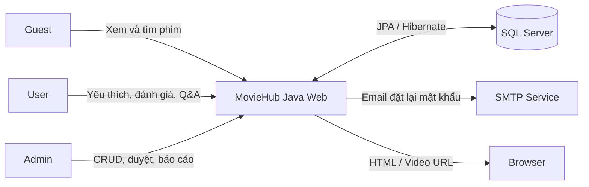
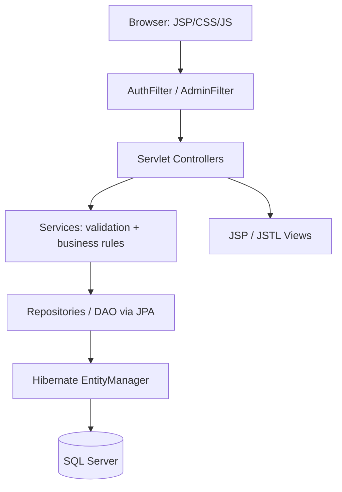
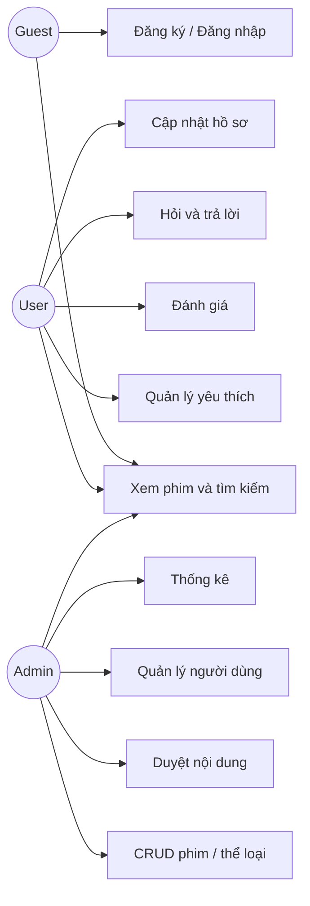
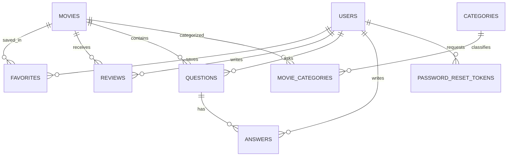
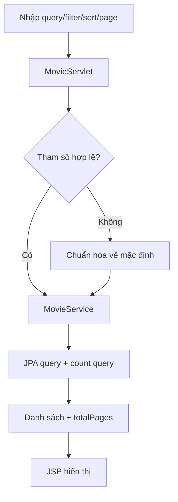
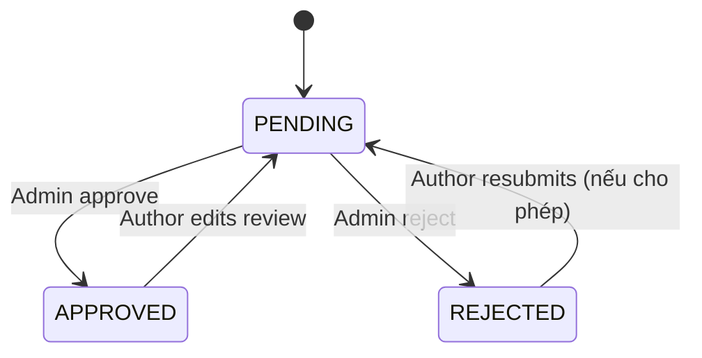

# MOVIEHUB — SOFTWARE REQUIREMENTS & PROJECT IMPLEMENTATION PLAN

> CẬP NHẬT CHỦ DỰ ÁN R-01 (2026-10-25): Phần quên mật khẩu trong baseline bên dưới đã được thay bằng luồng nhập email ACTIVE đã đăng ký → đặt mật khẩu mới ngay, không gửi/xác thực email, không OTP/reset token và không cần SMTP. Đặc tả hiện hành tại [001-auth v1.1.0](specs/001-auth/spec.md) và [R-01](specs/shared/decisions.md). Các đoạn mail/token/PasswordResetTokens trong tài liệu gốc chỉ là lịch sử, không phải yêu cầu triển khai mới.

> **Dự án:** Xử lý và hiển thị thông tin trên website xem phim  
> **Môn học:** PRJ301 — Java Web Application  
> **Phiên bản:** 1.0 | **Ngày:** 25/10/2026 | **Trạng thái:** Baseline đề xuất để nhóm thống nhất  
> **Quy mô:** 03 thành viên | **Mục tiêu:** Đơn giản, đủ nghiệp vụ, dễ demo, đáp ứng rubric  
> **Stack bắt buộc:** NetBeans 17 · Java Ant Web Application · JDK 17 · Apache Tomcat 10.1 · SQL Server · JPA/Hibernate · Servlet/JSP/JSTL

---

## 0. Cách đọc và nguyên tắc tài liệu

- **[ASSIGNMENT]**: Yêu cầu được nêu trong đề PRJ301 đã cung cấp.
- **[PROPOSED]**: Quyết định thiết kế của nhóm đề xuất, cần nhóm/giảng viên chốt nếu thay đổi phạm vi.
- **MUST**: Bắt buộc trong baseline; **SHOULD**: Nên có nếu còn thời gian; **OUT OF SCOPE**: Không làm.
- Mã tham chiếu: `UC-xx` use case, `US-xx` user story, `FR-xx` functional requirement, `NFR-xx` non-functional, `BR-xx` business rule, `TC-xx` test case.
- Hệ thống **không xây dịch vụ phát video quy mô lớn**. Chỉ phát video demo được cấp phép hoặc trailer hợp lệ qua URL/nguồn nội bộ phù hợp.

## 1. Executive summary & business context

### 1.1 Bài toán

Người dùng cần một website để khám phá phim, xem thông tin đáng tin cậy, lọc/tìm phim theo nhu cầu, xem trailer hoặc video demo, lưu phim yêu thích và trao đổi qua bình luận/hỏi đáp. Người quản trị cần nhập liệu và kiểm soát nội dung qua giao diện quản trị, thay vì sửa dữ liệu trực tiếp trong SQL Server.

### 1.2 Giải pháp

**MovieHub** là ứng dụng Java Web theo kiến trúc MVC: SQL Server lưu thông tin phim và tương tác; JPA/Hibernate truy cập dữ liệu; Servlet xử lý request; JSP/JSTL hiển thị. Có hai vai trò nghiệp vụ: **USER** và **ADMIN**; **GUEST** là trạng thái chưa đăng nhập, không phải role lưu trong DB.

### 1.3 Mục tiêu SMART [PROPOSED]

| ID | Mục tiêu | Đo nghiệm thu |
|---|---|---|
| OBJ-01 | Duyệt phim không cần tài khoản | Guest mở Home, danh sách và chi tiết phim |
| OBJ-02 | Tìm phim hiệu quả | Tìm theo tên; lọc thể loại/năm; sắp xếp; phân trang 10 phim/trang |
| OBJ-03 | Quản lý nội dung | Admin CRUD phim/thể loại; dữ liệu cập nhật hiện trên trang public |
| OBJ-04 | Cá nhân hóa đơn giản | User lưu/xóa yêu thích, đánh giá và đặt câu hỏi |
| OBJ-05 | Có báo cáo | Dashboard có COUNT/SUM/AVG/MAX/MIN từ SQL Server |
| OBJ-06 | Đáp ứng công nghệ | Chạy trên NetBeans 17, JDK 17, Tomcat 10.1, SQL Server qua JPA |

### 1.4 Phạm vi

**In scope (MVP):** xác thực, phân quyền, profile, danh sách/chi tiết phim, tìm kiếm/lọc/sắp xếp/phân trang, xem video demo, yêu thích, review 1–5 sao, Q&A có duyệt, admin CRUD, thống kê.

**Out of scope:** thanh toán/VIP, upload video lớn, mã hóa/chuyển mã video, HLS/DASH/CDN, chat realtime, recommendation bằng AI, hệ thống nhiều tập/phần phức tạp, ứng dụng mobile native, quản lý bản quyền thương mại. Gợi ý phim tương tự chỉ theo thể loại.

### 1.5 Giả định và ràng buộc

1. Dữ liệu mẫu có khoảng 30–50 phim, 5–10 thể loại và 2–3 tài khoản test.
2. Có Internet để tải ảnh poster từ URL; khi ảnh lỗi phải có placeholder.
3. Video demo có URL phát được trên trình duyệt; không mặc định mọi link YouTube đều chạy trong `<video>` (YouTube cần embed riêng và tuân thủ điều khoản).
4. Đề yêu cầu **JPA**, không dùng JDBC thuần cho nghiệp vụ.
5. Phần quên mật khẩu có thể dùng token reset gửi email nếu SMTP khả dụng; nếu không, cần cấu hình SMTP thử nghiệm trước buổi demo, không bỏ qua yêu cầu.
6. Không giả định có nội dung phim được cấp phép để phát công khai.

## 2. Stakeholders & actor definitions

| Actor | Mục đích | Quyền chính |
|---|---|---|
| Guest | Khám phá phim | Home, danh sách, tìm kiếm, chi tiết, xem trailer/video công khai, đăng ký/đăng nhập |
| User | Tương tác cá nhân | Guest + profile, yêu thích, đánh giá, hỏi/đáp, đăng xuất |
| Admin | Quản trị hệ thống | User + CRUD phim/thể loại, quản lý user, duyệt review/Q&A, thống kê |
| SQL Server | Lưu dữ liệu | Tài khoản, phim, thể loại, review, câu hỏi/trả lời, yêu thích |
| SMTP provider | Gửi email reset | Nhận yêu cầu từ backend và gửi link reset (nếu cấu hình) |
| Browser | Client | Gửi HTTP request, render JSP/HTML/CSS/JS, phát video |

## 3. System context

### 3.1 Context diagram (Mermaid)



### 3.2 System boundary

- **Bên trong:** auth, session, catalog, review, favorites, Q&A, admin dashboard, persistence.
- **Bên ngoài:** trình duyệt, SMTP, SQL Server, URL ảnh/video.
- **Trust boundary:** request từ browser là không đáng tin; kiểm tra input và role tại Servlet/Filter/Service, không chỉ ẩn nút trên JSP.

### 3.3 High-level architecture



**Luồng ví dụ:** `GET /movies?category=2&page=1` → MovieServlet → MovieService → MovieRepository/JPA → JSP render danh sách. `POST /admin/movies/create` → AdminFilter → validation → service → transaction → redirect.

## 4. Role & permission matrix

Ký hiệu: `R` đọc, `C` tạo, `U` cập nhật, `D` xóa, `M` duyệt/ẩn, `—` không được phép.

| Tài nguyên / chức năng | Guest | User | Admin |
|---|---|---|---|
| Trang chủ, phim công khai | R | R | R |
| Đăng ký / đăng nhập | C / Login | Login | Login |
| Profile của chính mình | — | R/U | R/U |
| Danh sách yêu thích của mình | — | C/R/D | C/R/D |
| Review của mình | — | C/R/U/D theo rule | C/R/U/D/M |
| Q&A công khai đã duyệt | R | R | R |
| Gửi câu hỏi/trả lời | — | C | C |
| CRUD phim/thể loại | — | — | C/R/U/D |
| Duyệt Q&A và review | — | — | M |
| Danh sách người dùng/đổi trạng thái | — | — | R/U |
| Dashboard thống kê | — | — | R |

**Admin không được tự ý xem mật khẩu gốc; mật khẩu chỉ lưu dưới dạng hash.**

## 5. Use case catalog

| ID | Use case | Actor | Ưu tiên | Liên kết FR |
|---|---|---|---|---|
| UC-01 | Đăng ký | Guest | P0 | FR-01 |
| UC-02 | Đăng nhập / đăng xuất | Guest/User/Admin | P0 | FR-02,03 |
| UC-03 | Quên và đặt lại mật khẩu | Guest | P0 | FR-04 |
| UC-04 | Cập nhật hồ sơ | User/Admin | P0 | FR-05 |
| UC-05 | Xem trang chủ | All | P0 | FR-07 |
| UC-06 | Tìm kiếm/lọc/sắp xếp/phân trang | All | P0 | FR-08,09 |
| UC-07 | Xem chi tiết và video demo | All | P0 | FR-10,11 |
| UC-08 | Thêm/xóa phim yêu thích | User/Admin | P0 | FR-12 |
| UC-09 | Đánh giá và bình luận phim | User/Admin | P0 | FR-13 |
| UC-10 | Đặt câu hỏi | User/Admin | P0 | FR-14 |
| UC-11 | Trả lời câu hỏi | User/Admin | P0 | FR-15 |
| UC-12 | CRUD phim | Admin | P0 | FR-17 |
| UC-13 | CRUD thể loại | Admin | P0 | FR-18 |
| UC-14 | Quản lý người dùng | Admin | P0 | FR-19 |
| UC-15 | Duyệt nội dung | Admin | P0 | FR-16,20 |
| UC-16 | Xem thống kê | Admin | P0 | FR-21 |
| UC-17 | Xem phim tương tự | All | P0 | FR-22 |

### 5.1 Use case diagram



### 5.2 Use case specifications chi tiết

#### UC-01 — Đăng ký
- **Actor:** Guest; **Trigger:** Nhấn Đăng ký.
- **Precondition:** Chưa đăng nhập.
- **Main flow:** (1) Mở form; (2) nhập họ tên/email/mật khẩu/xác nhận; (3) server validate; (4) kiểm tra email trùng; (5) hash mật khẩu; (6) lưu role USER, status ACTIVE; (7) thông báo thành công và chuyển login.
- **Alternative:** email trùng → thông báo; mật khẩu yếu/xác nhận khác → báo lỗi từng field; DB lỗi → không tạo tài khoản.
- **Postcondition:** Tạo đúng một user hợp lệ; mật khẩu không lưu plaintext.

#### UC-02 — Đăng nhập/đăng xuất
- **Actor:** Guest → User/Admin.
- **Main flow:** nhập email/mật khẩu → kiểm tra hash/status → tạo session → điều hướng Home hoặc Admin Dashboard; logout → invalidate session → về Home.
- **Alternative:** sai thông tin → thông báo chung; account INACTIVE → từ chối; URL admin không đúng role → 403.
- **Postcondition:** Session chứa user ID và role tối thiểu.

#### UC-03 — Quên/đặt lại mật khẩu
- **Actor:** Guest.
- **Main flow:** nhập email → hệ thống phát token một lần có hạn dùng → gửi link → user mở link → nhập mật khẩu mới → validate → lưu hash mới → token hết hiệu lực.
- **Alternative:** email không tồn tại vẫn phản hồi chung; token hết hạn/đã dùng → từ chối; SMTP lỗi → ghi log an toàn và báo thử lại.
- **Postcondition:** Mật khẩu đổi chỉ với token hợp lệ.

#### UC-04 — Cập nhật hồ sơ
- **Actor:** User/Admin.
- **Main flow:** mở profile → sửa tên/ảnh đại diện (URL tùy chọn) → validate → lưu → hiển thị cập nhật.
- **Alternative:** dữ liệu rỗng/quá dài/URL sai → giữ form và báo lỗi.
- **Postcondition:** Chỉ cập nhật tài khoản đang đăng nhập.

#### UC-05 — Xem Home
- **Actor:** All.
- **Main flow:** truy cập `/` → lấy phim PUBLISHED → hiển thị banner nổi bật, mới cập nhật, xem nhiều → bấm card mở chi tiết.
- **Alternative:** DB không có phim → empty state; ảnh lỗi → placeholder.
- **Postcondition:** Không lộ phim DRAFT/HIDDEN.

#### UC-06 — Tìm kiếm, lọc, sắp xếp, phân trang
- **Actor:** All.
- **Main flow:** nhập từ khóa → chọn thể loại/năm → chọn `newest`, `views`, `rating`, `title` → server lọc kết hợp → trả kết quả 10/trang và tổng số trang.
- **Alternative:** query trống → tất cả phim public; page âm/vượt phạm vi → chuẩn hóa hoặc hiển thị trang rỗng hợp lệ; không có kết quả → empty state.
- **Postcondition:** Bộ lọc được giữ trên link phân trang.

#### UC-07 — Chi tiết và phát video demo
- **Actor:** All.
- **Main flow:** mở `/movies/{id}` → hiện poster/tên/mô tả/năm/thời lượng/thể loại/điểm/lượt xem → video demo/trailer → danh sách tương tự.
- **Alternative:** phim không tồn tại/ẩn → 404; URL video thiếu → hiển thị “Chưa có video”; phát lỗi → fallback trailer/thông báo.
- **Postcondition:** Lượt xem được ghi tăng theo chính sách BR-09, không tăng khi refresh quá nhanh.

#### UC-08 — Quản lý yêu thích
- **Actor:** User/Admin.
- **Main flow:** tại chi tiết bấm “Yêu thích” → thêm cặp user–movie nếu chưa có; trang Favorites hiển thị danh sách; bấm bỏ → xóa liên kết.
- **Alternative:** Guest → yêu cầu login; đã tồn tại → giữ trạng thái; phim ẩn → không thêm mới.
- **Postcondition:** Mỗi user/phim chỉ có một bản ghi favorite.

#### UC-09 — Đánh giá phim
- **Actor:** User/Admin.
- **Main flow:** chọn 1–5 sao + bình luận → gửi → lưu PENDING → admin duyệt → hiển thị công khai và tính vào trung bình; người viết được sửa/xóa theo rule.
- **Alternative:** sai điểm/để trống comment/đã có review → báo lỗi hoặc chuyển sửa; nội dung không phù hợp → admin từ chối.
- **Postcondition:** Mỗi user tối đa một review trên mỗi phim.

#### UC-10 — Đặt câu hỏi
- **Actor:** User/Admin.
- **Main flow:** mở Q&A của phim → nhập câu hỏi → lưu PENDING → admin duyệt → câu hỏi hiện public.
- **Alternative:** chưa đăng nhập → login; nội dung quá dài/rỗng → validation; admin từ chối → không public.
- **Postcondition:** Có bản ghi question với author, movie, status, createdAt.

#### UC-11 — Trả lời câu hỏi
- **Actor:** User/Admin.
- **Main flow:** mở câu hỏi đã APPROVED → gửi câu trả lời → lưu PENDING → admin duyệt → hiển thị theo thời gian.
- **Alternative:** câu hỏi chưa duyệt/đã bị ẩn → không trả lời; nội dung lỗi → báo lỗi.
- **Postcondition:** Answer gắn đúng question và author.

#### UC-12 — CRUD phim
- **Actor:** Admin.
- **Main flow:** vào Admin Movies → danh sách → tạo/sửa tên, slug, mô tả, năm, thời lượng, posterUrl, videoUrl, trạng thái, thể loại → validate → lưu; xóa mềm bằng HIDDEN/DELETED.
- **Alternative:** slug trùng, dữ liệu không hợp lệ, category không tồn tại → từ chối; phim có tương tác → không hard delete.
- **Postcondition:** Public chỉ thấy PUBLISHED.

#### UC-13 — CRUD thể loại
- **Actor:** Admin.
- **Main flow:** thêm/sửa tên và slug thể loại → lưu → dùng khi gán phim; xóa chỉ khi không còn liên kết, hoặc dùng trạng thái ẩn.
- **Alternative:** trùng tên/slug → lỗi; đang gắn phim → chặn xóa.
- **Postcondition:** Không tạo tham chiếu mồ côi.

#### UC-14 — Quản lý user
- **Actor:** Admin.
- **Main flow:** xem danh sách, tìm email, đổi ACTIVE/INACTIVE; thay role USER/ADMIN theo BR-16.
- **Alternative:** tự vô hiệu hóa tài khoản admin cuối cùng → chặn; role không hợp lệ → chặn.
- **Postcondition:** Thay đổi quyền có hiệu lực ở request/session tiếp theo theo thiết kế.

#### UC-15 — Duyệt nội dung
- **Actor:** Admin.
- **Main flow:** xem queue review/questions/answers PENDING → APPROVE hoặc REJECT → cập nhật trạng thái, moderator và thời gian.
- **Alternative:** item đã duyệt → idempotent/no-op; item không tồn tại → 404.
- **Postcondition:** Chỉ nội dung APPROVED hiển thị public.

#### UC-16 — Dashboard thống kê
- **Actor:** Admin.
- **Main flow:** vào `/admin/dashboard` → hiển thị tổng user/phim/review, tổng lượt xem, lượt xem cao nhất/thấp nhất, điểm trung bình, số nội dung chờ duyệt.
- **Alternative:** dữ liệu rỗng → hiển thị 0 hoặc N/A phù hợp.
- **Postcondition:** Kết quả lấy từ SQL qua JPA aggregate queries.

#### UC-17 — Phim tương tự
- **Actor:** All.
- **Main flow:** ở chi tiết phim → lấy tối đa 6 phim PUBLISHED cùng ít nhất một thể loại, trừ phim hiện tại → hiển thị card.
- **Alternative:** không có phim tương tự → ẩn section hoặc hiện thông báo.
- **Postcondition:** Không hiển thị phim ẩn.

## 6. User stories & acceptance criteria

Định dạng: **As a [role], I want [goal], so that [benefit].** Các tiêu chí dùng Given/When/Then để dễ kiểm thử.

| ID | User story | Acceptance criteria (tóm tắt) | Priority |
|---|---|---|---|
| US-01 | As a guest, I want to register so that I can save movies. | Given email chưa có, when nhập hợp lệ, then tạo USER; email trùng bị chặn. | P0 |
| US-02 | As a guest, I want to log in so that I can use personal features. | Đúng credentials tạo session; sai không tạo session. | P0 |
| US-03 | As a user, I want to log out so that my session ends. | Sau logout truy cập Favorites chuyển login. | P0 |
| US-04 | As a user, I want to reset password so that I can recover access. | Token hợp lệ đổi được; token hết hạn/đã dùng không đổi được. | P0 |
| US-05 | As a user, I want to update my name so that my profile is accurate. | Chỉ sửa profile bản thân, không sửa người khác bằng URL. | P0 |
| US-06 | As a guest, I want featured/new/popular movies so that I can discover content. | Home có 3 nhóm dữ liệu SQL, chỉ PUBLISHED. | P0 |
| US-07 | As a guest, I want search by name so that I can find a movie. | Tìm không phân biệt hoa thường, hiển thị đúng phim. | P0 |
| US-08 | As a guest, I want filters and sorting so that I can narrow results. | Bộ lọc kết hợp, sort whitelist, phân trang giữ filter. | P0 |
| US-09 | As a guest, I want movie details so that I can decide to watch. | Hiện tên, poster, mô tả, năm, thể loại, thời lượng, đánh giá. | P0 |
| US-10 | As a guest, I want a demo player so that I can preview the movie. | Video hợp lệ phát được; URL lỗi có fallback. | P0 |
| US-11 | As a user, I want favorites so that I can revisit movies. | Thêm/xóa được, không có duplicate, guest không thao tác. | P0 |
| US-12 | As a user, I want to rate a movie so that I can share opinions. | 1–5 sao; 1 review/user/movie; chỉ APPROVED public. | P0 |
| US-13 | As a user, I want to ask about a movie so that others can help. | Câu hỏi lưu PENDING và chỉ hiện khi duyệt. | P0 |
| US-14 | As a user, I want to answer questions so that I can contribute. | Trả lời gắn câu hỏi APPROVED; chờ duyệt. | P0 |
| US-15 | As an admin, I want CRUD movies so that catalog stays current. | Tạo/sửa/ẩn phim; field lỗi không lưu. | P0 |
| US-16 | As an admin, I want CRUD categories so that movies are organized. | Chặn slug trùng, chặn xóa category đang dùng. | P0 |
| US-17 | As an admin, I want moderate user content so that public content is appropriate. | PENDING → APPROVED/REJECTED; audit moderator. | P0 |
| US-18 | As an admin, I want user management so that access is controlled. | Khóa user; không khóa admin cuối cùng. | P0 |
| US-19 | As an admin, I want statistics so that I can understand site activity. | Có COUNT, SUM, AVG, MAX, MIN; xử lý DB rỗng. | P0 |
| US-20 | As a guest, I want similar movies so that I can explore related titles. | Không hiện phim hiện tại, không hiện phim ẩn. | P0 |

### 6.1 Ví dụ acceptance criteria đầy đủ: US-08

```gherkin
Scenario: Search and filter published movies
  Given the database has published movies in multiple categories
  When the visitor searches "hero" and selects category "Action"
  And chooses sort "newest" and page 2
  Then only published movies matching both filters are shown
  And the list is sorted by release year descending
  And each page has at most 10 movies
  And pagination links preserve query, category, and sort

Scenario: Invalid sort is rejected safely
  When the visitor requests sort "DROP TABLE Movies"
  Then the server uses the default sort
  And no database error or SQL execution occurs
```

### 6.2 Definition of Ready / Done

- **Ready:** story có actor, business rule, màn hình, dữ liệu đầu vào, acceptance criteria.
- **Done:** code build được, phân quyền server-side, validate, test pass, merge branch, có screenshot demo, cập nhật tài liệu.

## 7. Functional requirements (FR)

| ID | Yêu cầu chức năng kiểm chứng được | Priority | UC |
|---|---|---|---|
| FR-01 | Hệ thống MUST đăng ký bằng name/email/password, chống email trùng, lưu password hash. | P0 | 01 |
| FR-02 | MUST xác thực email/password và tạo session cho tài khoản ACTIVE. | P0 | 02 |
| FR-03 | MUST đăng xuất và invalidate session. | P0 | 02 |
| FR-04 | MUST cung cấp luồng quên/đặt lại mật khẩu qua token có hạn dùng. | P0 | 03 |
| FR-05 | MUST cho user cập nhật thông tin hồ sơ của chính mình. | P0 | 04 |
| FR-06 | MUST kiểm tra USER/ADMIN tại server và trả 401/403 hoặc redirect phù hợp. | P0 | All |
| FR-07 | MUST hiển thị phim nổi bật, mới, xem nhiều lấy từ SQL Server. | P0 | 05 |
| FR-08 | MUST tìm theo tên, lọc thể loại/năm và sắp xếp hợp lệ. | P0 | 06 |
| FR-09 | MUST phân trang và giữ điều kiện tìm kiếm/lọc. | P0 | 06 |
| FR-10 | MUST hiển thị chi tiết phim và các metadata chính. | P0 | 07 |
| FR-11 | MUST hiển thị player cho URL video demo/trailer hợp lệ, có fallback. | P0 | 07 |
| FR-12 | MUST thêm, xem và bỏ yêu thích; chống bản ghi trùng. | P0 | 08 |
| FR-13 | MUST cho user đánh giá 1–5 sao và bình luận theo quy tắc duyệt. | P0 | 09 |
| FR-14 | MUST tạo câu hỏi gắn phim, mặc định PENDING. | P0 | 10 |
| FR-15 | MUST tạo câu trả lời gắn câu hỏi đã duyệt, mặc định PENDING. | P0 | 11 |
| FR-16 | MUST chỉ hiển thị Q&A APPROVED cho public. | P0 | 15 |
| FR-17 | MUST cho Admin tạo/xem/sửa/ẩn phim và gán thể loại. | P0 | 12 |
| FR-18 | MUST cho Admin CRUD thể loại, bảo toàn khóa ngoại. | P0 | 13 |
| FR-19 | MUST cho Admin xem/tìm/khóa user và quản lý role an toàn. | P0 | 14 |
| FR-20 | MUST cho Admin duyệt/từ chối review/question/answer. | P0 | 15 |
| FR-21 | MUST có thống kê COUNT/SUM/AVG/MAX/MIN từ dữ liệu thật. | P0 | 16 |
| FR-22 | MUST gợi ý phim cùng thể loại, loại trừ phim hiện tại. | P0 | 17 |
| FR-23 | MUST có trang 403/404/500 và trạng thái empty/loading/error hợp lý. | P0 | All |
| FR-24 | MUST validate dữ liệu cả client và server, thông báo rõ ràng. | P0 | All |
| FR-25 | SHOULD có breadcrumb và tìm kiếm trên navbar toàn trang. | P1 | 05–07 |
| FR-26 | SHOULD có dashboard biểu đồ đơn giản theo thể loại. | P1 | 16 |

## 8. Non-functional requirements (NFR)

| ID | Nhóm | Yêu cầu / cách kiểm thử |
|---|---|---|
| NFR-01 | Compatibility | Build và chạy trên JDK 17, NetBeans 17, Tomcat 10.1, SQL Server. |
| NFR-02 | Persistence | Hibernate/JPA dùng EntityManager, transaction rõ ràng; không JDBC thuần cho nghiệp vụ. |
| NFR-03 | Security | Hash mật khẩu BCrypt/Argon2; prepared/bound JPA parameters; escape output JSP; CSRF token cho POST thay đổi dữ liệu. |
| NFR-04 | Authorization | Kiểm tra quyền ở Filter/Servlet/Service; user không truy cập `/admin/*`. |
| NFR-05 | Performance | Với 50 phim và local DB, danh sách/chi tiết mục tiêu phản hồi dưới 2 giây trong điều kiện máy lab bình thường (mục tiêu đề xuất, cần đo). |
| NFR-06 | Usability | Desktop 1366px và mobile 375px không tràn ngang; có empty/error state. |
| NFR-07 | Reliability | Không lỗi 500 khi danh sách rỗng, URL phim sai, query page invalid. |
| NFR-08 | Maintainability | Phân lớp controller/service/repository/entity; không SQL trong JSP. |
| NFR-09 | Logging | Ghi log lỗi kỹ thuật và thao tác admin quan trọng; không log mật khẩu/token. |
| NFR-10 | Data integrity | Unique email/slug/favorite/review; foreign keys; transaction rollback khi lỗi. |
| NFR-11 | Accessibility | Form có label, ảnh có alt, keyboard focus dễ thấy, contrast đọc được. |
| NFR-12 | Deployment | Có README, SQL schema/seed, hướng dẫn cấu hình môi trường và demo accounts. |

## 9. Business rules (BR)

| ID | Quy tắc nghiệp vụ | Cách thực thi |
|---|---|---|
| BR-01 | Email duy nhất, không phân biệt hoa thường. | Normalize lower-case + UNIQUE. |
| BR-02 | Mật khẩu tối thiểu 8 ký tự; hash trước khi lưu. | Validate + BCrypt. |
| BR-03 | Đăng ký mặc định role USER, status ACTIVE. | Service. |
| BR-04 | Chỉ tài khoản ACTIVE được đăng nhập/tương tác. | AuthService + Filter. |
| BR-05 | Chỉ Admin CRUD phim/thể loại và duyệt nội dung. | Server-side authorization. |
| BR-06 | Chỉ phim PUBLISHED được hiện cho Guest/User. | Repository query filter. |
| BR-07 | Slug phim và thể loại phải duy nhất. | DB UNIQUE + service check. |
| BR-08 | Phim có review/favorite/Q&A không hard-delete; đổi HIDDEN. | Soft delete. |
| BR-09 | Một lượt xem được tính tối đa 1 lần / session / phim / 30 phút. | Session timestamp map; tránh refresh spam đơn giản. |
| BR-10 | Mỗi user chỉ có 1 favorite cho mỗi phim. | UNIQUE(user_id,movie_id). |
| BR-11 | Mỗi user chỉ có 1 review cho mỗi phim; điểm nguyên từ 1–5. | UNIQUE + CHECK/validation. |
| BR-12 | Review/question/answer mới có status PENDING; chỉ APPROVED công khai. | Moderation workflow. |
| BR-13 | Câu hỏi chỉ gắn phim tồn tại; câu trả lời chỉ gắn câu hỏi APPROVED. | Service + FK. |
| BR-14 | Nội dung review 1–1000 ký tự; câu hỏi 10–500; câu trả lời 1–1000. | Server validation. |
| BR-15 | Chỉ chủ sở hữu sửa/xóa review của mình; sửa xong chuyển lại PENDING. | Ownership + moderation. |
| BR-16 | Không cho admin cuối cùng bị khóa/hạ role; không tự khóa tài khoản đang dùng. | AdminService. |
| BR-17 | Token reset dùng một lần, hết hạn sau 15 phút; lưu token hash. | ResetToken service. |
| BR-18 | Sắp xếp chỉ từ whitelist; page >= 1; pageSize cố định 10 (hoặc giới hạn tối đa 50). | Query parser. |
| BR-19 | Điểm trung bình chỉ tính review APPROVED; phim chưa có review hiển thị “Chưa đánh giá”. | Aggregate query. |
| BR-20 | Phim tương tự: cùng thể loại, PUBLISHED, không trùng phim hiện tại, tối đa 6. | Repository query. |
| BR-21 | Năm phát hành trong khoảng 1888 đến năm hiện tại + 2; thời lượng 1–600 phút. | Validation. |
| BR-22 | Poster/video URL chỉ cho phép `https://` (local dev có thể cho phép `http://localhost`). | URL validation. |
| BR-23 | Admin duyệt phải ghi người duyệt và thời gian duyệt. | Audit fields. |
| BR-24 | Thống kê phải dựa dữ liệu SQL, không hardcode giá trị hiển thị. | Aggregate repository. |

## 10. Domain model & database design

### 10.1 Entities và fields

**Users**
- `id BIGINT IDENTITY PK`; `full_name NVARCHAR(100) NOT NULL`; `email VARCHAR(255) UNIQUE NOT NULL`; `password_hash VARCHAR(255) NOT NULL`; `role VARCHAR(10)` (`USER`,`ADMIN`); `status VARCHAR(10)` (`ACTIVE`,`INACTIVE`); `avatar_url VARCHAR(500) NULL`; `created_at DATETIME2`; `updated_at DATETIME2`.

**Movies**
- `id BIGINT IDENTITY PK`; `title NVARCHAR(200) NOT NULL`; `slug VARCHAR(250) UNIQUE`; `description NVARCHAR(MAX)`; `release_year INT`; `duration_minutes INT`; `poster_url VARCHAR(1000)`; `video_url VARCHAR(1000)`; `trailer_url VARCHAR(1000) NULL`; `status VARCHAR(15)` (`DRAFT`,`PUBLISHED`,`HIDDEN`); `featured BIT DEFAULT 0`; `view_count BIGINT DEFAULT 0`; `created_at`; `updated_at`.

**Categories**
- `id BIGINT IDENTITY PK`; `name NVARCHAR(100) UNIQUE`; `slug VARCHAR(120) UNIQUE`; `created_at`.

**MovieCategories**
- `movie_id BIGINT FK Movies`; `category_id BIGINT FK Categories`; `PRIMARY KEY(movie_id,category_id)`.

**Favorites**
- `id BIGINT IDENTITY PK`; `user_id FK Users`; `movie_id FK Movies`; `created_at`; `UNIQUE(user_id,movie_id)`.

**Reviews**
- `id BIGINT IDENTITY PK`; `user_id FK Users`; `movie_id FK Movies`; `rating TINYINT` (1–5); `content NVARCHAR(1000)`; `status VARCHAR(12)` (`PENDING`,`APPROVED`,`REJECTED`); `moderated_by BIGINT NULL FK Users`; `moderated_at DATETIME2 NULL`; `created_at`; `updated_at`; `UNIQUE(user_id,movie_id)`.

**Questions**
- `id BIGINT IDENTITY PK`; `movie_id FK Movies`; `user_id FK Users`; `content NVARCHAR(500)`; `status VARCHAR(12)`; `moderated_by FK Users NULL`; `moderated_at NULL`; `created_at`.

**Answers**
- `id BIGINT IDENTITY PK`; `question_id FK Questions`; `user_id FK Users`; `content NVARCHAR(1000)`; `status VARCHAR(12)`; `moderated_by FK Users NULL`; `moderated_at NULL`; `created_at`.

**PasswordResetTokens** *(bảng kỹ thuật để hoàn thành quên mật khẩu)*
- `id BIGINT IDENTITY PK`; `user_id FK Users`; `token_hash VARCHAR(255) UNIQUE`; `expires_at DATETIME2`; `used_at DATETIME2 NULL`; `created_at`.

> **Tổng:** 9 bảng vật lý nếu tách `MovieCategories` và `PasswordResetTokens`. Thiết kế ban đầu 8 bảng là mô tả rút gọn; bổ sung bảng reset token để đáp ứng nghiệp vụ quên mật khẩu thực tế.

### 10.2 ERD



### 10.3 Index & constraints

- Index: `Movies(status,release_year)`, `Movies(status,view_count)`, `Reviews(movie_id,status)`, `Questions(movie_id,status)`, `Answers(question_id,status)`.
- Unique: `Users(email)`, `Movies(slug)`, `Categories(slug)`, `Favorites(user_id,movie_id)`, `Reviews(user_id,movie_id)`.
- Không cascade xóa phim sang review/Q&A; ưu tiên soft delete.
- Dùng `NVARCHAR` cho nội dung tiếng Việt; timezone thống nhất (khuyến nghị lưu UTC và chuyển hiển thị).

### 10.4 Dữ liệu seed

- 30–50 phim demo, tối thiểu 6 thể loại: Hành động, Tình cảm, Hài, Kinh dị, Hoạt hình, Khoa học viễn tưởng.
- 1 admin, 2 users; 15 favorites, 20 reviews (có PENDING/APPROVED), 10 questions, 10 answers.
- Ảnh/video lấy từ nguồn demo hợp lệ hoặc nội dung được phép sử dụng; không nhúng URL vi phạm bản quyền.
- Seed phải **idempotent** (chạy lại không nhân đôi dữ liệu).

## 11. UI/UX & sitemap

### 11.1 Sitemap

```text
/
├── /movies                      (search, filter, sort, pagination)
├── /movies/{id}                 (details, player, reviews, Q&A, similar)
├── /login
├── /register
├── /forgot-password
├── /reset-password?token=...
├── /profile                     [USER/ADMIN]
├── /favorites                   [USER/ADMIN]
├── /admin                       [ADMIN]
│   ├── /admin/movies
│   ├── /admin/movies/create
│   ├── /admin/movies/edit?id=...
│   ├── /admin/categories
│   ├── /admin/users
│   ├── /admin/moderation
│   └── /admin/dashboard
├── /403
├── /404
└── /500
```

### 11.2 Design rules

- Dark cinematic theme, nền `#0B0F19`, surface `#151B28`, accent `#E63946`, text `#F4F6FA`; typography dễ đọc.
- Card phim poster tỷ lệ 2:3; ảnh có `loading="lazy"`; không dùng icon trang trí quá nhiều.
- Navbar: logo, search, thể loại, favorites (nếu login), profile/login.
- Home: hero featured + “Mới cập nhật” + “Xem nhiều” + “Đánh giá cao”.
- Movie detail: poster + metadata + CTA xem trailer/video + review + Q&A + phim tương tự.
- Admin: sidebar, data table, form validation, confirm trước thao tác ẩn/khóa.
- Responsive: desktop 5 card/hàng, tablet 3, mobile 2 (tùy chiều rộng).

### 11.3 Screen inventory

| Screen ID | Route | Thành phần | FR |
|---|---|---|---|
| UI-01 | `/` | Hero, các nhóm phim, navbar | 07 |
| UI-02 | `/movies` | Search, filter, sort, pagination | 08,09 |
| UI-03 | `/movies/{id}` | Poster, metadata, player, reviews, Q&A, similar | 10,11,13–16,22 |
| UI-04 | `/login` | Email, password, errors | 02 |
| UI-05 | `/register` | Form đăng ký | 01 |
| UI-06 | `/forgot-password` | Email nhận link | 04 |
| UI-07 | `/reset-password` | Password mới | 04 |
| UI-08 | `/profile` | Hồ sơ | 05 |
| UI-09 | `/favorites` | Danh sách yêu thích | 12 |
| UI-10 | `/admin/dashboard` | KPI, thống kê | 21 |
| UI-11 | `/admin/movies` | CRUD table | 17 |
| UI-12 | `/admin/movies/create/edit` | Movie form | 17 |
| UI-13 | `/admin/categories` | Category CRUD | 18 |
| UI-14 | `/admin/users` | User management | 19 |
| UI-15 | `/admin/moderation` | Review/Q&A queue | 20 |
| UI-16 | `/403`, `/404`, `/500` | Error pages | 23 |

## 12. Core business flows

### 12.1 Search flow



### 12.2 Moderation state



### 12.3 Password reset flow

1. User gửi email → backend trả thông báo chung, không tiết lộ email có tồn tại hay không.
2. Nếu có user: tạo random token mạnh, chỉ lưu hash và thời hạn 15 phút.
3. SMTP gửi link `https://<domain>/reset-password?token=...`.
4. Form gửi token + mật khẩu mới bằng POST; backend kiểm tra hash token/hạn dùng/usedAt.
5. Cập nhật hash mật khẩu, đánh dấu token đã dùng; thông báo thành công.

## 13. Technical implementation plan

### 13.1 Environment versions

| Thành phần | Chốt cấu hình |
|---|---|
| IDE | Apache NetBeans 17 |
| JDK | OpenJDK/Oracle JDK 17 |
| Servlet container | Apache Tomcat 10.1 (`jakarta.servlet.*`) |
| Web view | JSP + JSTL bản Jakarta-compatible |
| Database | Microsoft SQL Server, database `MovieHubDB` |
| ORM | Hibernate ORM 6.x / Jakarta Persistence API 3.x (chọn bản tương thích) |
| Build | **Apache Ant (Java Web Application with Ant trong NetBeans 17)**, tạo WAR bằng `build.xml` |
| Driver | Microsoft JDBC Driver for SQL Server, bản hỗ trợ Java 17 |
| Password hashing | BCrypt (thư viện Java tương thích) |

**Tương thích quan trọng:** Tomcat 10.1 dùng `jakarta.*`, không trộn với `javax.servlet.*`. Hibernate 6 dùng Jakarta Persistence. SQL Server JDBC driver vẫn là tầng driver phía dưới ORM; điều bị cấm là viết nghiệp vụ bằng JDBC thuần thay vì JPA.

### 13.2 SQL Server local configuration (theo yêu cầu nhóm)

```properties
# CHỈ DÙNG TRONG MÁY LOCAL DEMO - KHÔNG COMMIT FILE CÓ MẬT KHẨU
DB_HOST=localhost
DB_PORT=1433
DB_NAME=MovieHubDB
DB_USER=sa
DB_PASSWORD=123
```

- Tài khoản SQL Server local: **`sa`**, mật khẩu **`123`** (theo yêu cầu). Đây là mật khẩu yếu, chỉ sử dụng trong môi trường học tập cô lập.
- Để an toàn, trong repo chỉ commit `.env.example` với `DB_PASSWORD=CHANGE_ME`; cấu hình thật nằm ngoài Git hoặc trong biến môi trường của Tomcat.
- Bật SQL Server Authentication (Mixed Mode), TCP/IP và cổng phù hợp; xác nhận SQL Server instance thực tế trước khi cấu hình.
- **Khuyến nghị** đổi mật khẩu `sa` mạnh hơn và tạo user DB quyền tối thiểu ngay khi chạy trên mạng hoặc triển khai công khai.

Ví dụ JDBC URL *được Hibernate/JPA sử dụng* (không phải viết JDBC CRUD):

```properties
jakarta.persistence.jdbc.url=jdbc:sqlserver://localhost:1433;databaseName=MovieHubDB;encrypt=true;trustServerCertificate=true
jakarta.persistence.jdbc.user=${DB_USER}
jakarta.persistence.jdbc.password=${DB_PASSWORD}
```

> Lưu ý: `${...}` ở đây là ký hiệu cấu hình dự kiến; JPA `persistence.xml` **không tự động** thay biến môi trường theo cú pháp này. Cần mã bootstrap/config loader đọc env và truyền properties khi tạo `EntityManagerFactory`, hoặc cấu hình qua Tomcat JNDI. `trustServerCertificate=true` chỉ dùng local, không dùng production.

### 13.3 Tạo dự án Java Web Application with Ant trong NetBeans 17

1. Chọn **File → New Project → Java with Ant → Java Web → Web Application** (tên mục có thể khác đôi chút tùy plugin NetBeans đã cài).
2. Đặt tên **MovieHub**, chọn **JDK 17**, server **Apache Tomcat 10.1**, Jakarta EE Web profile tương thích nếu có tùy chọn.
3. Dùng **Ant `build.xml`** do NetBeans sinh để Clean and Build, tạo file WAR trong `dist/MovieHub.war`; **không dùng Maven `pom.xml` hoặc Gradle**.
4. Trong **Project Properties → Libraries**, thêm các file JAR cần thiết: Hibernate ORM 6.x và toàn bộ dependency tương thích, Microsoft JDBC Driver SQL Server, JSTL Jakarta, BCrypt và thư viện liên quan. Có thể dùng thư mục `lib/` lưu JAR được phép phân phối hoặc cấu hình library references để mọi thành viên build được.
5. Servlet API do Tomcat cung cấp, không đóng gói bản servlet API trùng vào `WEB-INF/lib`. Dùng import `jakarta.servlet.*`.
6. Đặt `META-INF/persistence.xml` trên classpath, ví dụ `src/java/META-INF/persistence.xml`; kiểm tra sau khi build nằm ở `WEB-INF/classes/META-INF/persistence.xml` trong WAR.
7. Cấu hình DB local bằng biến môi trường/Tomcat context, không hardcode mật khẩu trong source hoặc commit cấu hình thật.

**Cấu trúc thư mục tham khảo (Ant Web Application):**

```text
MovieHub/
├── build.xml                 # Ant build entry point (NetBeans tạo)
├── nbproject/                # Cấu hình Ant/NetBeans (project.xml, build-impl.xml...)
├── README.md
├── .gitignore
├── .env.example
├── database/
│   ├── 01_schema.sql
│   └── 02_seed.sql
├── docs/
│   └── MovieHub_Project_Plan.md
├── lib/                       # JAR Hibernate, SQL Server driver, JSTL, BCrypt + dependencies
├── src/
│   └── java/
│       ├── META-INF/persistence.xml
│       └── com/moviehub/
│           ├── controller/     # Servlet
│           ├── filter/         # AuthenticationFilter, AdminFilter
│           ├── service/        # Business logic
│           ├── repository/     # JPA EntityManager queries
│           ├── entity/         # JPA entities
│           ├── dto/
│           ├── util/           # JPAUtil, PasswordUtil, Validator
│           └── listener/
├── web/
│   ├── assets/css/
│   ├── assets/js/
│   ├── assets/img/
│   └── WEB-INF/
│       ├── web.xml            # Nếu cần cấu hình deployment
│       └── views/
│           ├── common/
│           ├── auth/
│           ├── movies/
│           ├── user/
│           ├── admin/
│           └── error/
├── test/                      # Java test sources (nếu cấu hình)
├── build/                     # Generated, không commit
└── dist/                      # MovieHub.war, không commit
```

**Ant workflow:** Clean and Build (`Shift+F11`) → kiểm tra `dist/MovieHub.war` → Run/Deploy lên Tomcat 10.1. Nếu máy NetBeans thiếu template Java Web with Ant, cần cài/bật module Java Web/Ant tương ứng, không chuyển sang Maven.

### 13.4 Route & HTTP method conventions

| Method | Route | Auth | Action |
|---|---|---|---|
| GET | `/` | Public | Home |
| GET | `/movies` | Public | Search/list |
| GET | `/movies/detail?id={id}` | Public | Detail (Servlet mapping đơn giản) |
| GET/POST | `/register` | Guest | Form/create user |
| GET/POST | `/login` | Guest | Form/authenticate |
| POST | `/logout` | User/Admin | Invalidate session |
| GET/POST | `/forgot-password` | Guest | Reset request |
| GET/POST | `/reset-password` | Guest | Set new password |
| GET/POST | `/profile` | User/Admin | Profile |
| GET | `/favorites` | User/Admin | List |
| POST | `/favorites/add` | User/Admin | Add |
| POST | `/favorites/remove` | User/Admin | Remove |
| POST | `/reviews/save` | User/Admin | Create/update review |
| POST | `/questions/create` | User/Admin | Ask |
| POST | `/answers/create` | User/Admin | Answer |
| GET | `/admin/dashboard` | Admin | Aggregates |
| GET/POST | `/admin/movies/*` | Admin | Movie CRUD |
| GET/POST | `/admin/categories/*` | Admin | Category CRUD |
| GET/POST | `/admin/users/*` | Admin | User management |
| GET/POST | `/admin/moderation/*` | Admin | Approve/reject |

**Quy tắc:** GET chỉ đọc; POST thay đổi dữ liệu; dùng Post/Redirect/Get để tránh gửi trùng khi refresh. Đối với `GET /movies/{id}` ở sitemap có thể cấu hình path mapping; bảng route chọn `detail?id` để nhóm triển khai Servlet dễ hơn, cần thống nhất một phương án trước khi code.

### 13.5 JPA & transaction

- Entity dùng `@Entity`, `@Table`, `@Id`, `@GeneratedValue`, `@ManyToOne`, `@ManyToMany` hoặc entity trung gian.
- Repository chỉ xử lý truy vấn; Service kiểm tra BR và quản lý transaction.
- Mỗi request/service tạo `EntityManager` theo phạm vi phù hợp; **không chia sẻ một EntityManager toàn ứng dụng**.
- `EntityManagerFactory` tạo một lần, đóng khi ứng dụng dừng.
- Dùng `setParameter`, không ghép chuỗi đầu vào người dùng vào JPQL.
- Phân trang bằng `setFirstResult`/`setMaxResults`; tổng bản ghi bằng count query.
- Aggregate JPQL: `COUNT(m)`, `SUM(m.viewCount)`, `AVG(r.rating)`, `MAX(m.viewCount)`, `MIN(m.viewCount)`.

## 14. Report/statistics specification

| KPI | Công thức/nguồn | Khi DB rỗng |
|---|---|---|
| Tổng phim | `COUNT(Movies)` (có thể tách published) | 0 |
| Tổng người dùng | `COUNT(Users WHERE role=USER)` | 0 |
| Tổng lượt xem | `SUM(Movies.viewCount)` | 0 |
| Lượt xem lớn nhất | `MAX(Movies.viewCount)` | N/A nếu không có phim |
| Lượt xem nhỏ nhất | `MIN(Movies.viewCount)` | N/A nếu không có phim |
| Điểm đánh giá TB | `AVG(Reviews.rating WHERE status=APPROVED)` | N/A |
| Nội dung chờ duyệt | COUNT PENDING từ Reviews + Questions + Answers | 0 |
| Phim xem nhiều nhất | Order by viewCount DESC, top 5 | Danh sách rỗng |

> `SUM` trên tập rỗng có thể trả NULL: chuyển thành 0 trong service/view model. Không dùng doanh thu vì dự án không có thanh toán.

## 15. Implementation roadmap (4 tuần đề xuất)

| Tuần | Deliverable | Người chính | Exit criteria |
|---|---|---|---|
| W1 | Repo Java Web Ant, cấu hình DB/JPA, schema, seed, layout, auth cơ bản | Cả nhóm; M1 auth | Build WAR, connect SQL Server, login/register |
| W2 | Home, list/search/filter/sort/paging, detail/player, movie/category CRUD | M2 + M3 | Demo dữ liệu thật từ DB |
| W3 | Favorites, review, Q&A, moderation, reset password, user management | M1 + M2 + M3 | End-to-end workflows chạy được |
| W4 | Dashboard, test, sửa lỗi, UI responsive, báo cáo, demo script | Cả nhóm | Rubric checklist 100%, không blocker |

### 15.1 Work breakdown theo thành viên

**Member 1 — Authentication & Security**
- Users entity/repository/service; đăng ký/login/logout; profile; reset password; session/filter; trang auth; test auth/permission.

**Member 2 — Movie Catalog & User Experience**
- Home, movie list/search/filter/sort/pagination, detail/player, similar movies, favorites, JSP/CSS; test catalog.

**Member 3 — Admin & Interaction**
- CRUD phim/thể loại, admin user management, reviews, Q&A, moderation, dashboard; test admin/moderation.

**Công việc chung:** thống nhất schema/API, migration/seed, UI guideline, review pull requests, tích hợp, demo.

### 15.2 Git workflow

- Branch `main` (stable), `dev` (integration), `feature/auth`, `feature/catalog`, `feature/admin`.
- Commit theo tính năng; PR vào `dev` phải build được, không commit credentials.
- Merge `dev` → `main` khi đạt checklist sprint; tag `v1.0-demo`.
- Mỗi người cập nhật README và ảnh chụp chức năng mình làm.

## 16. Testing plan & test cases

### 16.1 Levels

- **Unit:** validator, service logic, rule giới hạn.
- **Integration:** JPA + SQL Server thật (DB test riêng), transaction/constraint.
- **System:** trình duyệt + Tomcat + SQL Server, thao tác theo UC.
- **Security:** direct URL access, SQL injection attempt, XSS input, session/logout, CSRF.
- **UAT:** nhóm chạy demo checklist theo rubric.

### 16.2 Core test matrix

| TC | Scenario | Expected result | FR/BR |
|---|---|---|---|
| TC-01 | Đăng ký email mới | Tạo USER, hash password | FR-01, BR-01–03 |
| TC-02 | Đăng ký email trùng | Không tạo duplicate | FR-01 |
| TC-03 | Login đúng/sai | Đúng vào được, sai bị từ chối | FR-02 |
| TC-04 | User truy cập `/admin/dashboard` | 403/redirect, không lộ dữ liệu | FR-06 |
| TC-05 | Logout rồi vào `/favorites` | Bắt đăng nhập | FR-03 |
| TC-06 | Reset token hết hạn | Không đổi mật khẩu | FR-04, BR-17 |
| TC-07 | Home chỉ hiện PUBLISHED | DRAFT/HIDDEN không xuất hiện | FR-07, BR-06 |
| TC-08 | Search + filter + sort + page | Đúng tập dữ liệu, <=10 item | FR-08,09 |
| TC-09 | Sort chứa chuỗi SQL độc hại | Không thực thi; fallback sort | NFR-03, BR-18 |
| TC-10 | Chi tiết ID không tồn tại | 404, không 500 | FR-10 |
| TC-11 | Video URL rỗng | Placeholder, trang vẫn hoạt động | FR-11 |
| TC-12 | Thêm favorite 2 lần | Chỉ 1 record | FR-12, BR-10 |
| TC-13 | User gửi review rating 6 | Bị chặn | FR-13, BR-11 |
| TC-14 | Review PENDING | Không hiện public | FR-13, BR-12 |
| TC-15 | Admin approve review | Hiện public, cập nhật AVG | FR-20,21 |
| TC-16 | Guest gửi câu hỏi | Bắt đăng nhập | FR-14 |
| TC-17 | Answer cho question PENDING | Bị chặn | FR-15, BR-13 |
| TC-18 | Admin tạo phim trùng slug | Báo lỗi, không insert | FR-17, BR-07 |
| TC-19 | Xóa phim có tương tác | Chuyển HIDDEN, giữ dữ liệu | BR-08 |
| TC-20 | Xóa category đang dùng | Bị chặn | FR-18 |
| TC-21 | Khóa admin cuối cùng | Bị chặn | BR-16 |
| TC-22 | Dashboard trên DB rỗng | Không lỗi, 0/N/A đúng | FR-21 |
| TC-23 | User gửi `<script>` trong review | Render escaped, không chạy script | NFR-03 |
| TC-24 | POST không CSRF token | Request bị từ chối | NFR-03 |
| TC-25 | DB unavailable | Error page/log an toàn, không lộ password | NFR-07,09 |

### 16.3 Definition of acceptance

- 100% P0 use cases demo được bằng tài khoản test.
- Các TC-01…TC-25 được chạy, ghi Passed/Failed + bằng chứng; không tuyên bố pass khi chưa chạy.
- Không có lỗi truy cập admin bằng USER; không có mật khẩu plaintext trong DB/repo.
- Chạy được trên máy demo theo README; có seed và backup nếu cần.

## 17. Traceability to PRJ301 assignment

| Rubric trong assignment | Điểm | MovieHub đáp ứng bằng | Bằng chứng demo |
|---|---:|---|---|
| Xác thực người dùng | 1.0 | Register, login/logout, reset, profile, role/permissions | UC-01…04, FR-01…06 |
| Home & hiển thị dữ liệu | 2.0 | Nhóm phim, search/filter/sort/paging/detail/similar | UC-05…07,17 |
| CRUD | 2.0 | Movie, Category, moderation/user admin | UC-12…15 |
| Thống kê | 1.0 | MAX/MIN/AVG/SUM/COUNT | UC-16 |
| Giỏ hàng hoặc thay thế | 1.0 | Favorites: add/list/remove | UC-08 |
| Nâng cao / Framework | 1.0 | Hibernate/JPA với SQL Server | Entity/Repository/Persistence |
| Q&A | 2.0 | Questions, Answers, approval, display, management | UC-10,11,15 |
| **Tổng** | **10.0** | **Đủ hạng mục theo đề** | **Demo checklist** |

> Assignment gốc đánh số `3.3` rồi `3.5`; tài liệu giữ nguyên nội dung tiêu chí, không tự suy diễn có mục 3.4. Rubric là tiêu chí đánh giá, không đảm bảo điểm nếu sản phẩm chưa hoạt động đúng.

## 18. Risks & mitigation

| Risk | Xác suất / tác động | Giảm thiểu |
|---|---|---|
| Lỗi tương thích `javax`/`jakarta` | Trung bình / Cao | Chọn dependency Jakarta tương thích Tomcat 10.1 từ W1 |
| Hibernate kết nối SQL Server lỗi | Trung bình / Cao | Smoke test kết nối + CRUD entity ngay W1 |
| Quên mật khẩu phụ thuộc SMTP | Trung bình / Trung bình | Cấu hình SMTP test từ W1; demo token qua email test hợp lệ |
| Chồng chéo code khi merge | Cao / Trung bình | Tách package/module, review PR và merge thường xuyên |
| Thiếu dữ liệu để demo aggregate | Trung bình / Trung bình | Seed nhiều trạng thái, rating và view_count đa dạng |
| URL video bên ngoài lỗi | Cao / Trung bình | Có video demo được phép sử dụng, có fallback |
| Password SQL `sa/123` bị lộ | Cao nếu public / Cao | Chỉ local, không commit, đổi mật khẩu khi dùng mạng |
| Scope creep | Trung bình / Cao | Chốt P0, không thêm VIP/AI/streaming nâng cao |

## 19. Demo script (10–15 phút)

1. **(1 phút)** Giới thiệu MovieHub, 2 role, sơ đồ kiến trúc, SQL Server/JPA.
2. **(2 phút)** Guest vào Home → phim mới/xem nhiều → tìm “Action”, lọc năm, sort, page.
3. **(1 phút)** Mở chi tiết → metadata, player/trailer, similar movies.
4. **(2 phút)** Đăng ký/login User → cập nhật profile → add/remove favorite.
5. **(2 phút)** User gửi review + question → trạng thái chờ duyệt.
6. **(2 phút)** Login Admin → CRUD phim/thể loại → duyệt review/Q&A.
7. **(2 phút)** Quay lại public xác minh nội dung vừa duyệt; dashboard COUNT/SUM/AVG/MAX/MIN.
8. **(1 phút)** Thử user truy cập URL admin (403); kết luận phạm vi và công nghệ.

**Tài khoản demo:** tạo từ seed trên máy local; không ghi mật khẩu demo thật trong slide/repo public. **DB login `sa` không phải tài khoản đăng nhập website**.

## 20. Project deliverables & handover checklist

- [ ] NetBeans 17 Java Web Application with Ant (`build.xml`), build WAR và deploy Tomcat 10.1.
- [ ] SQL schema, seed, dữ liệu demo.
- [ ] JPA entities/repositories/services, không JDBC CRUD thuần.
- [ ] Trang JSP/CSS/JS theo screen inventory.
- [ ] Auth, profile, reset password, role filter.
- [ ] Home, search/filter/sort/page, detail, video, similar.
- [ ] Favorites, review, questions/answers, moderation.
- [ ] Admin CRUD phim/thể loại, user management, dashboard.
- [ ] README cài đặt: JDK 17, NetBeans 17, Ant project, Tomcat 10.1, SQL Server, JAR libraries, cấu hình env, build/deploy WAR.
- [ ] Test report + screenshot/video demo, sơ đồ context/use case/ERD.
- [ ] Bản báo cáo cuối cùng: bối cảnh, kiến trúc, thiết kế, chức năng, kết quả test, giới hạn.

## 21. Open decisions — chốt trước khi code

| Quyết định | Mặc định đề xuất | Người chốt |
|---|---|---|
| URL chi tiết phim | `/movies/detail?id=...` để Servlet đơn giản | Nhóm |
| Phát video | HTML5 MP4 demo có phép; trailer embed nếu cần | Nhóm |
| Reset email | SMTP test thật, token 15 phút | Nhóm |
| Review | 1 review/user/movie, sửa phải duyệt lại | Nhóm |
| Xóa phim | Soft delete bằng HIDDEN | Nhóm |
| Quyền admin | Seed admin đầu tiên, không cho user tự đăng ký admin | Nhóm |
| Thời lượng kế hoạch | 4 tuần (điều chỉnh theo lịch môn) | Nhóm |
| ORM | Hibernate 6.x + Jakarta Persistence, chốt patch khi setup | Nhóm |

---

## Appendix A — Glossary

| Thuật ngữ | Giải thích |
|---|---|
| Guest | Khách chưa đăng nhập |
| User | Tài khoản thường đã đăng nhập |
| Admin | Tài khoản quản trị |
| CRUD | Create / Read / Update / Delete |
| JPA | Chuẩn ánh xạ Java object ↔ database |
| Hibernate | ORM triển khai JPA |
| MVC | Model / View / Controller |
| JSP/JSTL | Công nghệ render giao diện Java Web |
| Soft delete | Ẩn dữ liệu thay vì xóa vật lý |
| Moderation | Quy trình duyệt nội dung |
| P0 | Bắt buộc để hoàn thành MVP |
| P1 | Nâng cao nếu đủ thời gian |

## Appendix B — Ghi chú nguồn và phạm vi

- **Nguồn yêu cầu môn học:** `Assignment_Loan(1).pdf`, 2 trang, phần mục tiêu, chủ đề và rubric PRJ301.
- **Nguồn ý tưởng sản phẩm:** Trao đổi trong cuộc hội thoại về MovieHub (website thông tin phim, user/admin, nhóm 3 người).
- **Các giá trị cụ thể** như giới hạn review, trạng thái duyệt, lịch 4 tuần, kích thước trang, quy tắc tính view, thiết kế bảng reset token và bảo mật là **đề xuất thiết kế**, không phải nguyên văn yêu cầu của assignment.
- **Điều kiện quan trọng:** Không đưa password DB `sa/123` vào mã nguồn public; chỉ dùng local demo.
