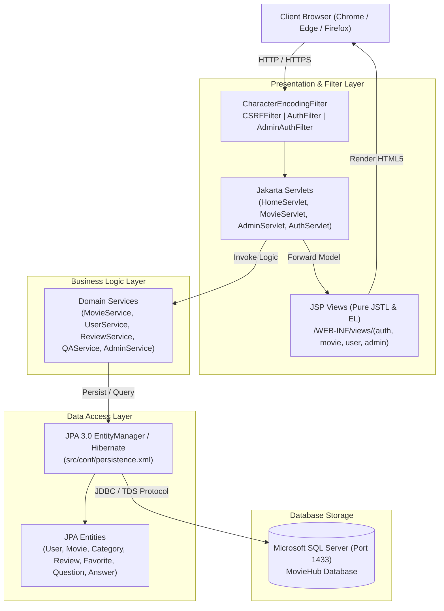

# 🎬 MovieHub — Cinematic Movie Streaming & Community Review Platform

<p align="center">
  
  
  
  
  
  
  
</p>

<p align="center">
  <strong>MovieHub</strong> is a modern, cinema-grade movie streaming, community review, and interactive Q&A management web application. Built natively on <strong>Java 17 LTS</strong> and <strong>Apache Tomcat 10.1</strong> (Jakarta EE 10 Web Profile), backed by <strong>Microsoft SQL Server</strong> with strict 3-tier MVC architectural boundaries.
</p>

<p align="center">
  <a href="#-key-features">Key Features</a> •
  <a href="#-tech-stack--environment">Tech Stack</a> •
  <a href="#-architecture">Architecture</a> •
  <a href="#-database--rich-seed-data">Database</a> •
  <a href="#-quick-start--setup">Setup & Run</a> •
  <a href="#-default-test-accounts">Test Accounts</a> •
  <a href="HUONG_DAN_CAI_DAT.md"><strong>📖 Hướng Dẫn Cài Đặt (Tiếng Việt)</strong></a>
</p>

---

## 🌟 Highlights

- **⚡ Blazing Fast & Lightweight**: Zero bloated frameworks. Built with native Jakarta Servlets, clean Java Services, and pure JSTL 2.0 views with zero scriptlets (`<% %>`).
- **🛡️ Enterprise Security**: BCrypt password hashing (cost $\ge$ 12), session fixation defense, CSRF token validation, HTTP-only secure cookies, and strict parameterized JPA queries against SQL injection.
- **🎥 Immersive Cinema UI**: Curated dark cinema aesthetics, responsive grid layout, high typographic contrast, YouTube embedded player, poster artwork, and fluid micro-interactions.
- **💬 Interactive Movie Community**: Real-time star ratings (1–5) with auto-calculated weighted averages, moderated user reviews, and threaded Q&A discussions.
- **📊 Executive Admin Studio**: Real-time KPI analytics counters, content CRUD (Movies, Categories) with soft-delete safeguards, and comprehensive review/Q&A moderation queues.
- **🌐 100% Vietnamese Unicode Integrity**: Comprehensive Anti-Mojibake compliance from SQL Server schemas (`NVARCHAR`) to UTF-8 JSP filters and client assets.

---

## 🚀 Key Features

```
┌─────────────────────────────────────────────────────────────────────────────┐
│                             MovieHub Platform                               │
├──────────────────────────────┬──────────────────────────────┬───────────────┤
│ 🍿 Cinema Experience         │ 👥 Community & Engagement    │ 🛡️ Management │
├──────────────────────────────┼──────────────────────────────┼───────────────┤
│ • Movie Catalog & Search     │ • 1–5 Star Rating System     │ • Admin Studio│
│ • Multi-attribute Filtering  │ • Written User Reviews       │ • Content CRUD│
│ • HD YouTube Video Player    │ • Threaded Q&A Community     │ • Moderation  │
│ • Watchlist / Bookmarking    │ • User Profile Passport      │ • Analytics   │
└──────────────────────────────┴──────────────────────────────┴───────────────┘
```

### 1. 🍿 Public Cinema Experience
- **Dynamic Hero Banner**: Showcases featured blockbuster movies with quick play and synopsis overview.
- **Multi-Attribute Search & Filter**: Instant filtering by genre, release year, duration, and keyword search.
- **Cinema Video Player**: Watch official movie trailers and HD video streams with custom cinema mode.
- **Personal Watchlist**: One-click bookmarking of movies to personal watchlist with instant visual feedback.

### 2. 💬 Community, Reviews & Q&A
- **Star Rating & Written Reviews**: Authenticated members can leave star ratings (1 to 5) and detailed reviews.
- **Auto-Calculated Metrics**: Dynamic recalculation of movie average rating and total review count.
- **Community Q&A Discussion**: Interactive questions and answers per movie with creator timestamps and moderation status.
- **Personal Profile Passport**: Member passport detailing join date, avatar, movie watchlist, review history, and password update.

### 3. 🛡️ Executive Admin Studio
- **Analytics Dashboard**: Real-time KPI statistics tracking total movies, published catalog, active users, pending reviews, and top-viewed titles.
- **Movie Management**: Complete CRUD operations for movies with slug generation, poster URL validation, YouTube video mapping, and category association.
- **Category Management**: Create, edit, and safely soft-delete movie genres with slug uniqueness validation.
- **Community Moderation Desk**: Review and approve/reject member reviews and Q&A submissions before public visibility.
- **User Account Management**: Admin control over user statuses (`ACTIVE`, `INACTIVE`) with session invalidation on suspension.

---

## 🛠 Tech Stack & Environment

| Layer | Technology / Specification | Notes |
| :--- | :--- | :--- |
| **Language Runtime** | **Java SE 17 LTS** | Compatible with modern Java 17/21 LTS runtimes. |
| **Web Server** | **Apache Tomcat 10.1.x** | Implements Jakarta EE 10 Web Profile (`jakarta.*` namespace). |
| **Database** | **Microsoft SQL Server 2019 / 2022** | Relational storage on port 1433 with ANSI/Unicode schemas. |
| **Persistence / ORM**| **JPA 3.0 / Hibernate 6.4.4** | Clean EntityManager, strictly parameterized `TypedQuery`. |
| **View Template** | **JSTL 2.0 / Jakarta Tags** | Pure EL (`jakarta.tags.core`), Zero Java Scriptlets (`<% %>`). |
| **Build Engine** | **Apache Ant** | Built-in NetBeans Ant Web Project automation. |
| **Security** | **jBCrypt 0.4 & Custom Filters** | BCrypt cost 12, CSRFFilter, AuthFilter, AdminAuthFilter. |

### 📦 Strict Permitted Libraries (`allowedlib`)
The project adheres to a strict library boundary. All runtime dependencies are deployed directly under `web/WEB-INF/lib/` without requiring external Maven repositories:
- `jakarta.servlet.jsp.jstl-3.0.1.jar` & `jakarta.servlet.jsp.jstl-api-3.0.0.jar`
- `jakarta.persistence-api-3.1.0.jar` & `hibernate-core-6.4.4.Final.jar`
- `sqljdbc42.jar` (Official Microsoft SQL Server JDBC Driver)
- `jbcrypt-0.4.jar` (BCrypt password hashing)
- Supporting bytecode and logging libraries (`byte-buddy`, `jboss-logging`, `classmate`, `jandex`).

---

## 🏗 Architecture

MovieHub implements a decoupled **Clean 3-Tier MVC Architecture**:



---

## 🗄 Database & Rich Seed Data

The database schema consists of **9 relational tables** enforcing foreign-key integrity, cascade deletes, and search indexes:

```
  Users (id, email, password_hash, full_name, role, status, avatar_url, created_at)
    ├── Favorites (user_id, movie_id, created_at) ── Movies (id, title, slug, poster_url, video_url, status)
    ├── Reviews (user_id, movie_id, rating, comment, status) ────┘         │
    ├── Questions (user_id, movie_id, content, status) ───────────────────┤
    │     └── Answers (question_id, user_id, content, status)             │
    └── MovieCategories (movie_id, category_id) ── Categories (id, name, slug)
```

### ⚡ 1-Click Automated Database Installation
The repository includes an automated batch installer in `database/`:
- **Windows Batch**: Double-click [`database/install.bat`](database/install.bat) to connect to `localhost:1433` (User `sa`, Password `123`) and seed all data automatically.
- **PowerShell**: Run `.\database\install.ps1 -Server "localhost" -Username "sa" -Password "123"`
- **Preloaded Data**:
  - **20 User Accounts**: 1 Administrator, 17 Active Members, 2 Inactive test users.
  - **13 Film Categories**: Action, Sci-Fi, Adventure, Drama, Horror, Animation, Comedy, etc.
  - **27 Feature Films**: 24 Published titles with official TMDB posters and verified YouTube trailers.
  - **105 Detailed Reviews**: Pre-approved community ratings and written feedback.
  - **28 Questions & 40 Answers**: Realistic community discussions with moderation states.

---

## ⚡ Quick Start & Setup

> 📘 **Xem hướng dẫn cài đặt chi tiết bằng tiếng Việt tại:** [**`HUONG_DAN_CAI_DAT.md`**](HUONG_DAN_CAI_DAT.md)

### 1. Prerequisites
- **JDK 17 LTS**: Check with `java -version`
- **Apache Tomcat 10.1.x**: Configured inside NetBeans
- **Microsoft SQL Server (2019/2022/Express)**: Port 1433, Mixed Mode Authentication, `sa` login enabled.

### 2. Database Setup
Run the automated installation script:
```cmd
cd database
install.bat
```
*(Or execute scripts `01_schema.sql` through `08_seed_qa.sql` in SQL Server Management Studio).*

### 3. Database Connection Configuration
If your SQL Server credentials differ from `sa / 123`, update [`src/conf/persistence.xml`](src/conf/persistence.xml):
```xml
<property name="jakarta.persistence.jdbc.url" value="jdbc:sqlserver://localhost:1433;databaseName=MovieHub;encrypt=false;trustServerCertificate=true;" />
<property name="jakarta.persistence.jdbc.user" value="sa" />
<property name="jakarta.persistence.jdbc.password" value="YOUR_PASSWORD" />
```

### 4. Build & Run in NetBeans
1. Open **Apache NetBeans** -> **File** -> **Open Project...** -> Select `MovieHub`.
2. If prompted with *Missing Server*: Right-click Project -> **Properties** -> **Run** -> Select your **Apache Tomcat 10.1** instance.
3. Right-click Project -> **Clean and Build**.
4. Right-click Project -> **Run** (or press **F6**).
5. Open browser at:
   - **Public Site**: [http://localhost:8080/MovieHub/](http://localhost:8080/MovieHub/)
   - **Admin Studio**: [http://localhost:8080/MovieHub/admin](http://localhost:8080/MovieHub/admin)

### 5. Local Ant CLI Build (Optional)
```powershell
# Compile Java classes
& "C:\Program Files\NetBeans-17\netbeans\extide\ant\bin\ant.bat" compile

# Run automated test suite
& "C:\Program Files\NetBeans-17\netbeans\extide\ant\bin\ant.bat" test

# Build deployable WAR distribution (dist/MovieHub.war)
& "C:\Program Files\NetBeans-17\netbeans\extide\ant\bin\ant.bat" dist
```

---

## 🔑 Default Test Accounts

All pre-seeded test accounts use the common password: **`Password123!`**

| Role | Email Login | Password | Full Name | Access Scope |
| :--- | :--- | :---: | :--- | :--- |
| **ADMIN** | `admin@moviehub.vn` | `Password123!` | Admin MovieHub | Executive dashboard, movie CRUD, category CRUD, reviews & Q&A moderation. |
| **USER** | `tuan.nguyen@moviehub.vn` | `Password123!` | Nguyễn Thanh Tuấn | Movie streaming, watchlist bookmarking, 5-star ratings, Q&A discussions. |
| **USER** | `mai.le@moviehub.vn` | `Password123!` | Lê Thị Tuyết Mai | Cinema streaming, review authoring, community engagement. |
| **USER** | `duc.tran@moviehub.vn` | `Password123!` | Trần Minh Đức | Sci-Fi enthusiast, review authoring, discussion contributor. |
| **INACTIVE** | `hung.lam@moviehub.vn` | `Password123!` | Lâm Quốc Hưng | Suspended member account (tests authentication guardrails). |

---

## 📁 Project Directory Structure

```text
MovieHub/
├── .sdd/                        # Spec-Driven Development architecture constraints & RFCs
├── database/                    # SQL Server installation & seed scripts (01 to 08)
│   ├── install.bat              # 1-Click automated database installer
│   ├── 01_schema.sql            # Table definitions, constraints, indexes
│   ├── 02_reset_data.sql        # Clean data & reset identity counter
│   ├── 03_seed_users.sql        # 20 pre-configured test users
│   ├── 04_seed_categories.sql   # 13 cinematic genres
│   ├── 05_seed_movies.sql       # 27 movies with TMDB posters & YouTube video URLs
│   ├── 06_seed_favorites.sql    # User watchlist associations
│   ├── 07_seed_reviews.sql      # 105 star ratings and reviews
│   └── 08_seed_qa.sql           # Community Q&A discussions
├── docs/                        # Architecture documentation, DB schema & route inventory
├── nbproject/                   # NetBeans Ant project configuration
├── specs/                       # 8 Core functional specification modules
│   ├── 001-auth/                # User authentication, registration, recovery
│   ├── 002-user-profile/        # Profile passport & password update
│   ├── 003-movie-catalog/       # Catalog, filtering, keyword search, detail player
│   ├── 004-favorites/           # Personal movie watchlist
│   ├── 005-reviews-rating/      # 1-5 Star rating & review engine
│   ├── 006-qa/                  # Community Q&A interaction
│   ├── 007-admin-crud/          # Administrative movie, category & user management
│   └── 008-admin-analytics/     # Executive KPI analytics dashboard
├── src/
│   ├── conf/persistence.xml     # JPA 3.0 / Hibernate configuration
│   └── java/com/moviehub/       # 3-Tier Java Source Code
│       ├── controller/          # Jakarta Servlets (auth, movie, user, admin, qa)
│       ├── entity/              # JPA Model Entities (User, Movie, Review, etc.)
│       ├── filter/              # CharacterEncoding, CSRF, Auth, AdminAuth filters
│       ├── service/             # Transactional Business Logic Services
│       └── util/                # Password hashing, validation, string utilities
├── test/com/moviehub/           # Automated JUnit 4 test suites
├── web/
│   ├── WEB-INF/
│   │   ├── lib/                 # The strictly permitted runtime JARs
│   │   ├── views/               # Pure JSTL 2.0 JSP Views (zero scriptlets)
│   │   └── web.xml              # Deployment descriptor & servlet route mappings
│   └── assets/                  # CSS stylesheets, client scripts, icons, images
├── HUONG_DAN_CAI_DAT.md         # Detailed Vietnamese installation guide for clients
└── README.md                    # Project documentation
```

---

## 📜 Development Standards & Governance

MovieHub was developed in accordance with the **MovieHub Engineering Constitution**:
1. **Spec-First, Code-Second**: Every feature module is designed and verified against formal specifications in `specs/` with EARS acceptance criteria before implementation.
2. **Zero Scriptlet Policy**: Strict prohibition of Java scriptlets (`<% ... %>`) in `.jsp` files. All rendering is achieved using standard JSTL 2.0 tags and Expression Language (`${...}`) with default XML escaping.
3. **Anti-Mojibake UTF-8 Standard**: Zero character corruption in Vietnamese diacritics across all database records, queries, HTTP headers, templates, and JavaScript payloads.
4. **Validation Gate Enforcement**: Automated compilation, unit testing, and architectural boundary checks before branch delivery.

---

## 📄 License & Attribution

- Built as an enterprise showcase application for **PRJ301 / Java Web Application**.
- Posters and movie metadata sourced for educational and demonstration purposes from [The Movie Database (TMDB)](https://www.themoviedb.org/) and [YouTube](https://www.youtube.com/).
