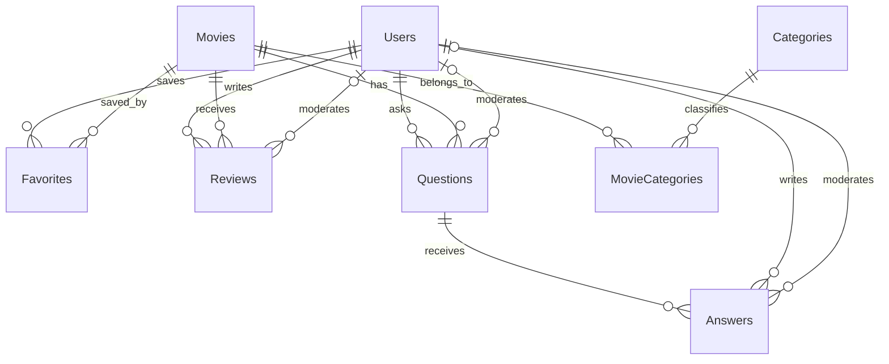

# Database MovieHub — SQL Server

Ngày thiết kế: 2026-10-25. Phạm vi: thiết kế và thiết lập database theo yêu cầu trực tiếp của chủ dự án; không triển khai thêm chức năng web.

## Cơ sở thiết kế

Dùng [hợp đồng dữ liệu](../../specs/shared/data-contract.md), các module 001–008 và quyết định R-01. Schema dùng tên bảng/cột tương thích entity `User` hiện tại. SQL Server local đã có `MovieHub.dbo.Users` với 5 hàng trước khi triển khai; phải giữ nguyên dữ liệu đó.

Các hướng đã cân nhắc:

- Tạo lại database: đơn giản nhưng làm mất tài khoản đang có, không phù hợp.
- Bổ sung schema vào database hiện tại: chọn cách này vì giữ dữ liệu và hỗ trợ chạy lại.
- Để Hibernate tự tạo bảng: không chọn vì cần quản lý rõ constraint/index và không được để ORM tự thay schema.

Thiết kế dùng 8 bảng nghiệp vụ. Không tạo mới `PasswordResetTokens`: R-01 không dùng token; nếu database khác đã có bảng lịch sử này thì script giữ nguyên.

## Quan hệ

## Từ điển và ràng buộc

| Bảng | Nội dung | Ràng buộc chính |
|---|---|---|
| Users | Tên, email, hash BCrypt, quyền/trạng thái, avatar, timestamps | Email canonical unique; USER/ADMIN; ACTIVE/INACTIVE; version và credentials_version |
| Movies | Tiêu đề, slug, mô tả, năm, thời lượng, URL media, featured, views | Slug unique; DRAFT/PUBLISHED/HIDDEN; views BIGINT không âm; duration 1–600 |
| Categories | Tên, name_key canonical, slug, created_at, deleted_at | Key so sánh nhị phân; slug unique kể cả đã xóa mềm |
| MovieCategories | movie_id, category_id | PK ghép, hai FK; index đảo để lọc theo thể loại |
| Favorites | user_id, movie_id, created_at, deleted_at | Unique user/movie cả khi đã xóa mềm |
| Reviews | user/movie, rating, nội dung, duyệt, timestamps, deleted_at | Rating 1–5; unique user/movie; version/content_revision |
| Questions | movie/user, nội dung, duyệt, created_at | Nội dung 10–500; version; FK moderator |
| Answers | question/user, nội dung, duyệt, created_at | Nội dung 1–1000; version; FK moderator |

ID là BIGINT IDENTITY; text tiếng Việt dùng NVARCHAR. Timestamp mới dùng DATETIME2(7), mặc định SYSUTCDATETIME(). Users có sẵn được giữ nguyên cả kiểu avatar NVARCHAR và default timestamp cũ; JPA hiện có luôn truyền Instant UTC ở @PrePersist/@PreUpdate. Không tự diễn giải lại timestamp lịch sử.

Các trạng thái duyệt là PENDING/APPROVED/REJECTED. PENDING không có moderator/time; quyết định APPROVED/REJECTED phải có cả hai. FK không cascade delete; bỏ favorite/review và category bằng deleted_at, phim ẩn bằng status. Không lưu điểm trung bình/count suy ra: tính từ các review đủ điều kiện qua JPA.

Email ASCII có unique index trên cột tính toán `email_key` trim/lowercase, không cần map để ghi trong JPA. Category dùng `name_key NVARCHAR(300)` do Service tạo bằng NFC → trim → lowercase với Locale.ROOT và ghi cùng `name` trong mỗi create/edit. Unique key dùng Latin1_General_100_BIN2: phân biệt dấu và không gộp Straße/Strasse hoặc i/i có dấu chấm. Dành sức chứa lớn hơn tên gốc cho trường hợp Unicode lowercase mở rộng ký tự. Không dùng SQL LOWER để mô phỏng hoàn toàn Unicode lowercase của Java. Entity Category tương lai cần map nameKey bắt buộc; seed SQL cũng phải cung cấp key canonical. Service vẫn kiểm tra email/URL/slug; SQL không thay thế validation Unicode/URL ở ứng dụng.

SQL bảo vệ miền giá trị, FK, uniqueness và sự đầy đủ audit. Service/transaction chịu trách nhiệm: năm tối đa năm hiện tại+2; publish cần category còn dùng và poster hợp lệ; không gán category đã xóa; không xóa category đang liên kết; không duyệt khi parent không public; moderator phải Admin ACTIVE; giữ Admin ACTIVE cuối; tăng version/credentials_version/content_revision đúng thao tác. Không thêm trigger nghiệp vụ hay tự tăng version ngoài JPA. Mỗi dashboard cần transaction đọc nhất quán theo plan module 008; script không thay isolation hoặc ngắt kết nối khác.

## Tiêu chí nghiệm thu

- DB-AC-01: WHEN chạy setup trên database mới THE script SHALL tạo đủ 8 bảng, FK, unique/check constraints và index.
- DB-AC-02: WHILE Users đã tồn tại THE script SHALL giữ nguyên tài khoản/hash/role/status và dừng an toàn nếu không tương thích.
- DB-AC-03: WHEN chạy setup lần nữa THE script SHALL không tạo hàng trùng hoặc thay dữ liệu hiện có.
- DB-AC-04: IF FK không tồn tại, rating ngoài 1–5, trạng thái sai hoặc user/movie trùng THEN SQL Server SHALL từ chối ghi.
- DB-AC-05: WHEN kiểm tra schema THE tests SHALL rollback toàn bộ fixture, không để lại nội dung demo.
- DB-AC-06: THE setup SHALL không lưu mật khẩu mới trong repo và SHALL không thay login sa hoặc cấu hình instance.

## Chạy và kiểm tra

Xem [database/README.md](../../database/README.md). DDL chỉ dùng lúc triển khai; CRUD ứng dụng tiếp tục qua JPA → Service → DTO → Servlet → JSP. Không thêm JAR hoặc JDBC CRUD vào ứng dụng. Không seed tự động hay tự cấp quyền ADMIN cho tài khoản hiện có. Seed demo 30–50 phim trong data-contract là công việc chuẩn bị demo riêng, cần nguồn media và mật khẩu seed từ môi trường.
